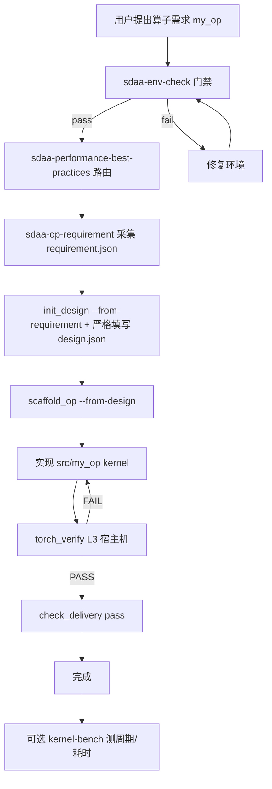
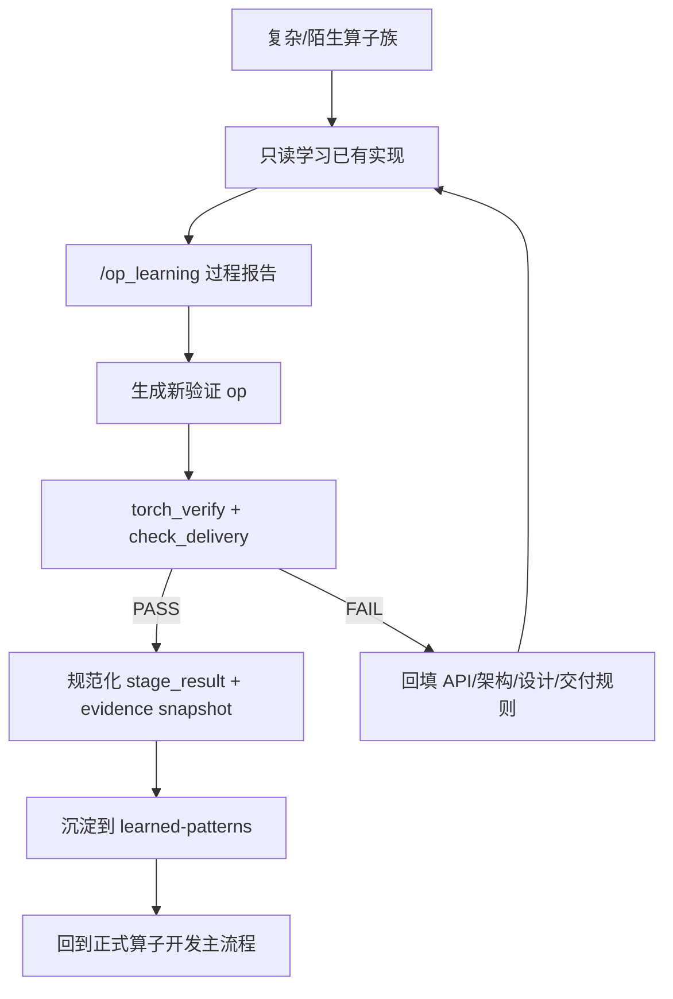
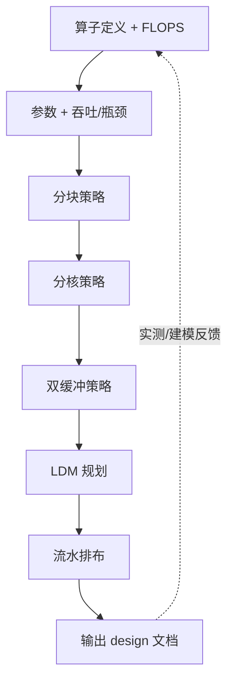
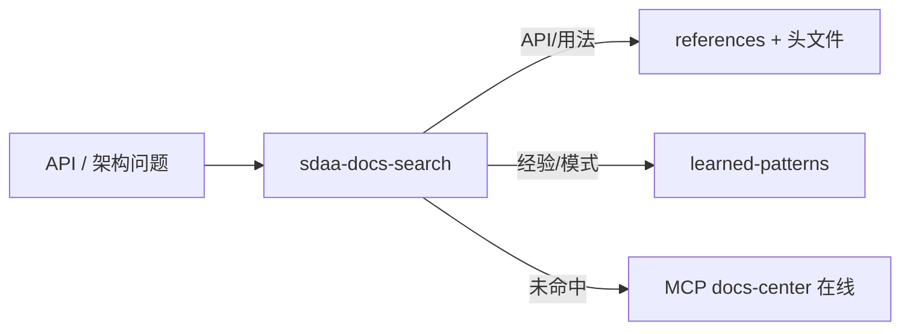

# TECO Ops Agent 项目现状总览

> 当前默认算子工作树已从 `swdnn_test_ops` 迁移为外部 sibling 仓库 `../../teco-ops`。
> 新算子默认按 teco-ops 的 interface + UAL 布局落地，并通过
> `ops/kernel-bench/scripts/teco_ops_test.py` 调用 teco-ops C++ 测试框架完成正确性和性能验收。
> 文中涉及 `swdnn_test_ops` / `torch_verify.py` / `check_delivery.py` 的段落仅作为历史兼容路径参考。

TECO Ops Agent 是面向 **SDAA / TECO T1** 平台的算子开发 Demo Agent：将环境检查、架构知识、API 最佳实践、算子设计与工程脚手架封装为 **Skills**，配合本机 LLM（Codex / Cursor / Claude Code）辅助分析与实现。

---

## 1. 项目定位

| 维度 | 说明 |
|------|------|
| 目标用户 | 算子开发工程师、平台验证人员、Agent 编排开发者 |
| 核心能力 | 从「环境门禁 → 查文档/架构/经验 → 算子设计 → 单文件 .swcu 脚手架 → PyTorch 精度验收」的端到端工作流 |
| 运行形态 | IDE Agent（Codex / Cursor / Claude Code）+ `run_cli.py` 命令行 |
| Demo 工程 | `teco-ops` sibling 仓库（默认相对路径 `../../teco-ops`） |

---

## 2. 仓库结构

```
teco-ops-agent/
├── AGENTS.md                 # 主 Agent 指令（Codex / Cursor）
├── CLAUDE.md                 # 指向 AGENTS.md 的软链接（Claude Code）
├── README.md                 # 快速开始
├── init.sh                   # Skills 安装到 .codex / .cursor / .claude
├── run_cli.py                # CLI 入口
├── configs/
│   ├── llm_runtime.json      # LLM 运行时配置
│   ├── backend_config.json   # tracked backend 默认配置
│   ├── backend_config.local.json # 未跟踪的个人 backend 路径覆盖
│   └── codex_mcp.example.toml #MCP相关配置
├── teco_ops_agent/           # Python 运行时（LLM + skill 上下文收集）
├── .codex/config.toml        # 项目级 Codex hooks 配置
├── docs/                     # 项目文档、开发进度、代码规范、共享知识库
├── ops/                      # Skills（见 §3）
└── ../../teco-ops/           # 默认算子工作树（外部 sibling 仓库）
    ├── src/<op>/             # 单文件 .swcu 算子实现
    ├── op_design/<op>/       # 算子设计文档（design.json + design.md）
    └── common/               # 公共头文件、torch I/O、verify
```

---

## 3. 功能模块一览

### 3.1 运行时与 CLI（`teco_ops_agent/`）

| 组件 | 功能 |
|------|------|
| `config.py` | 读取 `configs/llm_runtime.json`、Codex `config.toml`、Claude settings |
| `llm.py` | LLM Responses API + `/chat/completions` 回退；支持 Codex 扁平配置与 Claude 环境变量 |
| `skills_runtime.py` | `agent-ask` 时执行 env-check、加载 arch 文档片段 |
| `cli.py` | 子命令：`llm-plan`、`llm-chat`、`agent-ask` |

| CLI 命令 | 说明 |
|----------|------|
| `python3 run_cli.py llm-plan` | 打印当前 provider / model / base_url |
| `python3 run_cli.py llm-chat "<prompt>"` | **裸 LLM**，不执行 skills |
| `python3 run_cli.py agent-ask "<prompt>"` | **推荐**：先 env-check + arch，再问答 |
| `python3 run_cli.py agent-ask ... --verbose` | 打印 skill 执行步骤 |

### 3.2 `sdaa-env-check` — 环境门禁

**用途**：算子开发前验证 SDK、编译链、设备可用性。

| 脚本 | 功能 |
|------|------|
| `check_env.sh` | 检查 setvars、tecocc、cmake、sdaa_runtime.h、teco-smi、python3 |
| `check_env.sh --json -o file` | 结构化输出，供编排器解析 |
| `device_info.py --json` | 设备时钟、显存、架构标识（UAL_TECO100 / T1） |
| `device_info.py --idle` | 返回空闲设备 index（`gid:auto` 选卡） |

**参考文档**：`env_config_guide.md`、`codex-sandbox-env-check.md`、`troubleshooting.md`

> **注意**：Codex 沙箱内 `teco-smi` 可能误报驱动未加载，须在宿主机终端复验。

### 3.3 `sdaa-docs-search` — 本地文档检索

**用途**：在 skills references、头文件、知识库中全文检索 API。

| 脚本 | 功能 |
|------|------|
| `build_index.py` | 构建/更新本地 `.md` / `.h` 索引 |
| `search_docs.py --query "rt_dma_iget" --json` | 检索，JSON 供 Agent 消费 |

**检索优先级**：docs-search skill → thirdParty 头文件 → MCP 在线（内网 `docs-center`）。

### 3.4 `sdaa-performance-best-practices` — 性能优化最佳实践入口

**用途**：性能优化知识的总入口，不重复维护 API 手册或长期 pattern 正文；按机制层、算子族和验证流程路由到对应 skill。

| 路由方向 | 读取内容 |
|----------|----------|
| DMA / RMA / LDM / ACE / SIMD / batch API | `sdaa-docs-search` |
| T1 架构、tile、带宽、LDM bank | `sdaa-performance-best-practices` → `learned-patterns/` |
| 设计、分块、分核、流水 | `sdaa-op-design` |
| 单点/组合 attempt、经验沉淀 | `sdaa-op-learning-validation` |

**使用原则**：

- 新算子设计和已有 kernel 优化前先读该入口，再检索 learned-patterns。
- 入口只负责路由；长期可消费经验仍写入 `ops/sdaa-op-learning-validation/references/learned-patterns/`。
- 它不做硬 hook 阻断；现有 `UserPromptSubmit` hook 只做 advisory 提醒。

### 3.5 `sdaa-op-requirement` — 算子需求采集

**用途**：新算子开发的强制第一步，逐字段采集并确认算子名称、shape、shape 含义、公式、IO、dtype、golden 容差，产出结构化 `requirement.json`。

| 脚本 | 功能 |
|------|------|
| `collect_requirement.py --from-json` | 校验临时 JSON 并写入正式 requirement |

**需求存储**：

```
swdnn_test_ops/op_requirements/<op>/
  requirement.json
```

**执行原则**：

- 每个字段必须由用户确认；Agent 可以给建议，但不能批量默认填充。
- 即使算子功能明确（如 GEMM），也必须确认 shape、dtype、公式和 IO。
- Agent 环境中不要直接跑 `collect_requirement.py --op <op>` 的 stdin 交互；应先构造临时 JSON，再用 `--from-json` 校验写入。
- 下游 `sdaa-op-design` 使用 `init_design.py --from-requirement` 读取该产物。

### 3.6 `sdaa-op-design` — 算子设计（workflow v3）

**用途**：从需求产出结构化设计文档，驱动脚手架与 kernel 实现。

| 脚本 | 功能 |
|------|------|
| `init_design.py` | 初始化 `op_design/<op>/design.json` + `design.md` |
| `validate_design.py` | 严格校验 schema 3.0，`--render-md` 同步人类可读文档 |
| `op_design_lib.py` | schema 定义、校验、渲染、`apply_design_to_scaffold` |

**设计存储**：

```
swdnn_test_ops/op_design/<op>/
  design.json    # schema 3.0，机器可读
  design.md      # 与流程图同结构，人类可读
```

**design.json 章节（顺序）**：

| # | 字段 | P0 | 说明 |
|---|------|:---:|------|
| 1 | `operator_definition` | ✓ | 算子语义、IO、公式 |
| 1b | `flops` | ✓ | 每元素 / 总 FLOPS |
| 2 | `parameters` | ✓ | shapes、dtype、超参 |
| 2b | `throughput_model` | ✓ | 算术强度、瓶颈类型 |
| 3 | `tiling_strategy` | | 分块轴、tile 大小 |
| 4 | `core_partition_strategy` | | 32 SPE 分核 |
| 5 | `double_buffer_strategy` | | 双缓冲张量 |
| 6 | `ldm_planning` | ✓ | 256KB buffer 表 |
| 7 | `pipeline_layout` | | DMA / 计算流水 |
| 8 | `scaffold` + `golden` | | 族、PyTorch 容差 |

### 3.7 `sdaa-op-template` — 工程脚手架、Hooks 与验收

**用途**：从设计生成单文件 `.swcu` 算子、单算子 CMake 作用域编译、PyTorch 精度验收、交付检查，并承载写新算子前的 Codex hook 入口。

| 脚本 | 功能 |
|------|------|
| `scaffold_op.py` | 生成 `src/<op>/<op>.swcu`；必须 `--from-design` 读 design.json |
| `scope_cmake_op.py` | 单算子 CMake 作用域，避免兄弟算子链接冲突 |
| `cmake_baseline.py` | CMake 3.10、tecocc、LINK_FLAGS 修复(**针对现阶段的demo算子框架**) |
| `torch_verify.py` | L0 编译 + L3 PyTorch golden 对比（**唯一精度验收**） |
| `torch_golden_lib.py` | PyTorch golden 生成辅助 |
| `scripts/hooks/new_op_preflight.py` | Codex `UserPromptSubmit` hook：识别任意已登记算子族与优化/实现/开发/修改动作，自动读取领域索引、机制 learned-patterns 与 code-style；纯测试不触发 |

**单文件布局**：

```text
src/<op>/
  <op>.swcu              # device kernel + host test driver
  <op>_torch_golden.py   # PyTorch golden
common/torch_io.h        # f32/f16 bin I/O
```

不再生成 args struct、`.hpp` kernel 文件或 `<op>_demo.swcu` 五件套。

**分层验收**：

| 层 | 工具 | 说明 |
|----|------|------|
| L0 | `torch_verify.py --build-only` | 编译通过 |
| L1/L2 | `verify_sanity.h` | shape / NaN 检查 |
| L3 | `torch_verify.py` | PyTorch golden（**唯一精度标准**） |

**Codex hook**：

项目级 `.codex/config.toml` 默认启用 `UserPromptSubmit` hook。用户请求新算子或 kernel 优化时会自动提示必须读取：

- `ops/sdaa-performance-best-practices/SKILL.md`
- `ops/sdaa-op-learning-validation/references/learned-patterns/`
- `docs/code-style.md`

算子族路由采用“人工登记、自动消费”：`domain-routes.json` 保存 GEMM、Attention、Sparse Attention
等领域的触发词、继承关系、README 和必读 pattern。请求同时命中任意领域与优化/实现/开发/修改
动作词时，即使没有写“算子”或“kernel”，hook 也会自动触发。例如“继续优化 gemm”会进入
GEMM 路由；“测试 matmul”或“benchmark gemm”不会触发实现 Preflight，而由测试 skill 处理。

新增 convolution、normalization、MoE 等领域不再修改 Python：只需新增 `<family>/README.md`、
在 `domain-routes.json` 登记 route，并同步更新性能入口的领域路由表。具体维护步骤见
`ops/sdaa-op-learning-validation/references/learned-patterns/README.md` 的“新增算子族路由”。

### 3.8 `sdaa-op-learning-validation` — 算子模式学习与迁移验证

**用途**：单独用于提升和验证 Agent 的算子实现迁移能力；不是普通算子交付的强制步骤。

适用场景：

- 新算子族或陌生实现模式，现有 verified pattern 不足。
- 复杂路径涉及 ACE / DMA / RMA / SIMD 复合流水，Agent 不确定如何排 wait/sync。
- 生成失败后，需要从已有实现只读学习并回填规则。
- 需要把某类实现模式沉淀为长期 skill 知识。

**产物分层**：

| 产物 | 路径 | 说明 |
|------|------|------|
| 学习过程报告 | `swdnn_test_ops/op_learning/<topic>/learned_patterns.md` | 记录本次样本、推理、失败日志、验证 op |
| 稳定知识沉淀 | `ops/sdaa-op-learning-validation/references/learned-patterns/<family>/<pattern>.md` | 验证通过后保留可复用规则、适用条件、反例 |
| 验证算子设计 | `swdnn_test_ops/op_design/<op>/` | 仍走正式 design / scaffold / verify 流程 |

**使用原则**：普通算子生成仍走 §4.1 主流程；只有复杂/陌生模式才先走 learning-validation，验证通过后再把稳定规则回填到本 skill 或对应领域 skill。

### 3.9 `kernel-bench` — Kernel 周期与耗时测量

**用途**：在 L3 精度验收通过后，使用 `rt_time_cycle()` 对 device 端 kernel 整体执行周期做轻量 benchmark。

| 脚本 | 功能 |
|------|------|
| `bench_kernel.py --op <op>` | 临时插桩 `.swcu`，编译运行后输出最大 SPE 周期数与时间 |

**执行示例**：

```bash
python3 ops/kernel-bench/scripts/bench_kernel.py \
  --op <op> --demo-root ./swdnn_test_ops --json
```

**范围边界**：

- 前置条件是 `torch_verify.py` L3 已通过。
- 脚本会备份并恢复 `.swcu`，插入 `rt_time_cycle()` 计时点。
- 输出 kernel 整体 `max_cycles` / `time_us`，不拆 DMA、RMA、ACE、SIMD 分项。
- 它是性能观察工具，不替代 `check_delivery.py` 的交付门禁。

### 3.10 backend 配置与多 backend 支持

`sdaa-op-learning-validation` 支持多 backend。tracked `configs/backend_config.json` 只保存可共享默认值，
个人绝对路径写入未跟踪的 `configs/backend_config.local.json`：

```json
{
  "backends": {
    "teco_ops": { "demo_root": "../../teco-ops" }
  }
}
```

| 配置项 | 说明 |
|--------|------|
| `demo_root` | 各 backend 的仓库路径，支持绝对路径或相对路径（相对于 teco-ops-agent 仓库根目录） |
| 命令行 `--demo-root` | 最高优先级 |
| `--backend` | `init_learning_task.py` / `promote_design_facts.py` 的参数，不传默认 `teco_ops` |

`validate_learned_patterns.py` 校验仓库内 portable evidence ID，不依赖作者机器上的原始 stage_result。

### 3.11 `record-repo-change` — 仓库问题与功能记录

修复 hook、CLI、脚本、配置、安装或 skill 流程问题，或完成仓库级功能支持后，向
`docs/问题记录/YYYY-MM.md` 按完成顺序追加一条 6–10 行的简短记录。只保留核心问题或需求、核心方案、验证和关键文件；确需展开时，将详细内容放入 `docs/问题记录/核心方案/` 并由月度记录引用；
算子 kernel、精度和性能问题仍由 `sdaa-op-learning-validation` 管理。

---

## 4. 模块流转流程

### 4.1 端到端算子开发（主流程）



**禁止**：搜索已有算子替代 `my_op`；禁止设计完成即结束。

### 4.1b 可选前置：实现模式学习验证

当目标算子族或实现路径缺少已验证模式时，先单独运行 `sdaa-op-learning-validation`：



学习验证通过 `--backend` 指定 backend，路径优先级为 `--demo-root` >
`configs/backend_config.local.json` > 仓库默认。

这个分支用于学习和沉淀，不用于替代用户请求的正式算子交付。

### 4.2 算子设计内部迭代（workflow v3）



### 4.3 知识查阅链路



### 4.4 执行路径选型（实现阶段）

```
大块 matmul?  → ACE (rt_ace_*)
逐元素/规约?  → batch_* / reduce_*（首选）
融合多步?     → simd_load + 手写循环
HBM↔LDM?     → rt_dma_iget/iput + 双缓冲 + 周期划分
核间通信?     → rt_rma_iput / col_reduce / allreduce
```

详见 `sdaa-docs-search` 及 `learned-patterns/` 中的执行路径参考。

### 4.5 Agent 调度顺序（AGENTS.md）

| Step | 模块 | 动作 |
|------|------|------|
| 1 | env-check | `check_env.sh --json`、`device_info.py` |
| 2 | docs-search + performance-best-practices | 按需检索 API 与经验 |
| 3 | arch | 确认 UAL、DMA 约束、ACE 选型 |
| 4 | LLM | `agent-ask` 分析总结 |
| 5 | op-design → op-template | 设计 → 脚手架 → 实现 → 验收 |

---

## 5. 安装与集成

安装、MCP、Cursor、Claude Code 和验证命令统一维护在 [快速开始](快速开始.md)。本节只记录当前仓库注册的 skills 与集成入口。

**已注册 Skills**（`init.sh` `INCLUDED_SKILLS`）：

```
sdaa-env-check
sdaa-docs-search
sdaa-performance-best-practices
sdaa-op-design
sdaa-op-requirement
sdaa-op-template
sdaa-op-learning-validation
kernel-bench
record-repo-change
```

Codex 项目级 hook 配置：`.codex/config.toml`。Claude Code Plugin 市场定义：`.claude-plugin/marketplace.json`。

---

## 6. 样例

### 6.1 环境检查

```bash
bash ops/sdaa-env-check/scripts/check_env.sh --json -o /tmp/env_check.json
python3 ops/sdaa-env-check/scripts/device_info.py --json
```

### 6.2 文档检索

```bash
python3 ops/sdaa-docs-search/scripts/build_index.py
python3 ops/sdaa-docs-search/scripts/search_docs.py --query "rt_dma_iget" --json --top 5
```

### 6.3 算子设计 → 脚手架（rmsnorm_forward）

```bash
# 1. 初始化设计
python3 ops/sdaa-op-design/scripts/init_design.py \
  --op rmsnorm_forward \
  --computation-type normalization \
  --summary "fp16 RMSNorm forward"

# 2. 完善 design.md 后校验
python3 ops/sdaa-op-design/scripts/validate_design.py \
  --op rmsnorm_forward --render-md --json

# 3. 生成单文件 .swcu
python3 ops/sdaa-op-template/scripts/scaffold_op.py \
  --op rmsnorm_forward --from-design --patch-runsh

# 4. 实现 kernel 后 PyTorch 验收（宿主机，非沙箱）
python3 ops/sdaa-op-template/scripts/torch_verify.py \
  --op rmsnorm_forward \
  --demo-root ./swdnn_test_ops \
  --build-dir build_rmsnorm_forward \
  --scope-cmake --restore-cmake --json
```

更多强制落地规则见 `ops/sdaa-op-template/references/mandatory-delivery-flow.md`。

### 6.4 本地验证算子与学习验证样例

子模块内会保留若干本地验证算子和学习验证产物，作为脚手架、L3 验收和性能尝试的参考。

| 路径 | 说明 |
|------|------|
| `swdnn_test_ops/src/gemmex/gemmex.swcu` | 当前 GEMMEX 单文件验证算子 |
| `swdnn_test_ops/op_design/gemmex/` | GEMMEX design v3 文档 |
| `ops/sdaa-op-learning-validation/references/learned-patterns/` | 已验证经验沉淀 |

当前 GEMMEX 关键阶段：

- 4x8 2D split-K baseline：`128946366 cycles / 54.638 ms`，L3 pass。
- A/B 双缓冲：正确但性能回退，已记录并回退。
- A 复用 across N：`66898770 cycles / 28.347 ms`，L3 pass，并沉淀为 `gemm/a-reuse-across-n.md`。

### 6.5 Agent 问答

```bash
python3 run_cli.py agent-ask \
  "总结当前环境，并说明 RMSNorm 应走 EBOX 还是 ACE" \
  --verbose
```

### 6.6 Codex hook 验证

```bash
printf '%s' '{"prompt":"优化 SATE kernel 的 DoubleBuffer 和 gemm_write pipeline"}' \
  | python3 ops/sdaa-op-template/scripts/hooks/new_op_preflight.py
```

首次启动 Codex 时，如果提示 `Hooks need review`，需要确认允许执行本仓库 `.codex/config.toml` 中声明的 hook 命令；确认后，新算子前置检索 hook 才会运行。

---

## 7. 文档索引

### 7.1 项目级

| 文档 | 路径 |
|------|------|
| 快速开始 | [README.md](../README.md) |
| Agent 主指令 | [AGENTS.md](../AGENTS.md) |
| **项目现状总览（本文）** | [docs/项目文档/TECO Ops Agent项目现状总览.md](TECO%20Ops%20Agent项目现状总览.md) |
| 快速开始（Codex / Cursor / Claude Code） | [docs/项目文档/快速开始.md](快速开始.md) |
| 代码规范 | [docs/code-style.md](../code-style.md) |
| 共享知识库 | [docs/共享知识库/README.md](../共享知识库/README.md) |
| 开发验证进度 | [docs/开发文档/sdaa-op-learning-validation开发验证进度.md](../开发文档/sdaa-op-learning-validation开发验证进度.md) |

### 7.2 各 Skill 入口

| Skill | SKILL.md |
|-------|----------|
| `kernel-bench` | [ops/kernel-bench/SKILL.md](../../ops/kernel-bench/SKILL.md) |
| `sdaa-env-check` | [ops/sdaa-env-check/SKILL.md](../../ops/sdaa-env-check/SKILL.md) |
| `sdaa-docs-search` | [ops/sdaa-docs-search/SKILL.md](../../ops/sdaa-docs-search/SKILL.md) |
| `sdaa-performance-best-practices` | [ops/sdaa-performance-best-practices/SKILL.md](../../ops/sdaa-performance-best-practices/SKILL.md) |
| `sdaa-op-requirement` | [ops/sdaa-op-requirement/SKILL.md](../../ops/sdaa-op-requirement/SKILL.md) |
| `sdaa-op-design` | [ops/sdaa-op-design/SKILL.md](../../ops/sdaa-op-design/SKILL.md) |
| `gemm-performance-modeling` | [ops/sdaa-op-design/references/gemm-performance-modeling/SKILL.md](../../ops/sdaa-op-design/references/gemm-performance-modeling/SKILL.md) |
| `sdaa-op-template` | [ops/sdaa-op-template/SKILL.md](../../ops/sdaa-op-template/SKILL.md) |
| `sdaa-op-learning-validation` | [ops/sdaa-op-learning-validation/SKILL.md](../../ops/sdaa-op-learning-validation/SKILL.md) |
| `record-repo-change` | [ops/record-repo-change/SKILL.md](../../ops/record-repo-change/SKILL.md) |

### 7.3 方法论来源（已本地化）

以下文档已蒸馏进 `sdaa-docs-search` / `sdaa-performance-best-practices` skills：

| 原始文档 | 蒸馏落点 |
|----------|----------|
| SWAI ACE介绍 | `ace-overview.md`、`ace-api.md` |
| T1-ACE使用方法论 | `ace-methodology.md` |
| T1-DMA-RMA访存优化方法论 | `dma-rma-methodology.md` |
| SIMD使用手册-zh | `simd-vs-batch.md`、`execution-path-selection.md` |

原始资料已复制到 `ops/sdaa-op-design/references/source-docs/`，避免运行时依赖外部文档路径。

### 7.4 设计 schema 与样例 JSON

| 文档 | 路径 |
|------|------|
| 设计流程 | `ops/sdaa-op-design/references/workflow.md` |
| JSON schema | `ops/sdaa-op-design/references/design-schema.md` |
| 吞吐建模 | `ops/sdaa-op-design/references/throughput-model.md` |
| LDM 规划 | `ops/sdaa-op-design/references/ldm-planning.md` |
| 样例 JSON | `ops/sdaa-op-design/references/example-rmsnorm_forward.json` |

---

## 8. 当前状态与待办

### 8.1 已完成

- [x] Skills 安装与 AGENTS.md 编排
- [x] LLM 接入（Codex 扁平配置 + chat completions 回退 + Claude settings）
- [x] 算子设计 workflow v3（schema 3.0）+ 脚手架 `--from-design`
- [x] 单文件 `.swcu` 模板 + `torch_verify.py` + `check_delivery.py`
- [x] ACE / DMA-RMA / SIMD 方法论蒸馏进 arch / librt / kernel skills
- [x] 性能最佳实践入口与 SATE 路由接入
- [x] rmsnorm_forward Agent 跑通样例沉淀
- [x] Codex `UserPromptSubmit` hook：配置驱动识别 GEMM/Attention/Sparse Attention 等领域与代码修改动作，自动读取领域索引、learned-patterns 和 code-style；纯测试请求独立路由

### 8.2 子模块本地工作（未全部推送远端）

`swdnn_test_ops` 含本地验证算子：

- `l2norm_forward`（bf16，design v5 + kernel）
- `rmsnorm_forward`（fp16）
- `op_design/` 设计文档

### 8.3 规划中

- tiling-design 独立 skill（当前分块逻辑在 op-design 内）
- test-runner 自动化批量验收
- 更多算子族 pattern 和 hook 门禁（PreToolUse / Stop）

---

## 9. 相关仓库

| 仓库 | 关系 |
|------|------|
| `gongry/teco-ops-agent` | 本仓库（skills + CLI + Agent） |
| `gupeng/swdnn_test_ops` | 子模块（demo 算子工程） |

```bash
test -d ../../teco-ops
```
