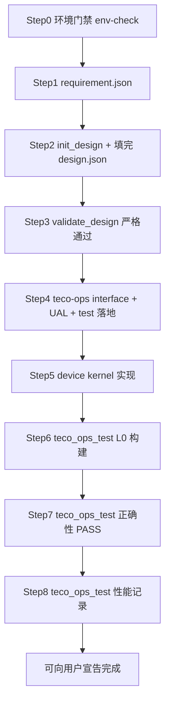

# 算子落地验收强制流程（teco-ops）

> **任务完成定义**：用户请求开发算子 `my_op` 时，Agent 不得在仅完成设计文档后结束；必须走完 **设计 -> teco-ops interface + UAL 落地 -> kernel 实现 -> teco-ops C++ 测试框架正确性和性能验收** 全链路，且 `teco_ops_test.py` 报告 PASS。

## 1. 强制阶段（不可跳过）



| 阶段 | 命令 / 产物 | 通过标志 |
|------|-------------|----------|
| 0 环境 | `check_env.sh --json` | `status: pass` |
| 1 需求 | `collect_requirement.py --from-json ... --json` | `<demo_root>/op_requirements/<op>/requirement.json` |
| 2 设计 | `init_design.py --from-requirement` + 填写 `op_design/<op>/design.json` | 文件存在且字段完整 |
| 3 设计门禁 | `validate_design.py --op <op> --render-md --json` | `valid: true` |
| 4 落地 | teco-ops interface / UAL / test 文件 | `<op>` 新增文件存在 |
| 5 实现 | 编辑 `.cpp` / `.h` / `.hpp` / `.scpp` | kernel 无未实现 TODO |
| 6 编译 L0 | `teco_ops_test.py --build-only --json` | returncode 为 0 |
| 7 正确性 | `teco_ops_test.py --case-path ... --json` | demo returncode 为 0 |
| 8 性能 | `teco_ops_test.py --perf-repeat 50 --warm-repeat 3 --gtest-repeat 1 --json` | 命令成功并保留输出 |

`teco_ops_test.py` 封装 teco-ops 官方测试链：

```bash
bash build.sh --build teco
cd test
source env.sh
sh build.sh --arch teco
./build/demo --gid=0 --warm_repeat=3 --perf_repeat=50 --gtest_repeat=1 \
  --case_path=zoo/teco/<op>/test_case/case_0.prototxt
```

## 2. teco-ops 落地文件清单

新增算子至少覆盖：

```text
../../teco-ops/
  teco/interface/include/tecoops.h
  teco/interface/ops/<op>.cpp
  teco/ual/args/<op>_args.h
  teco/ual/ops/<op>/<op>.hpp
  teco/ual/ops/<op>/find_<op>.h
  teco/ual/ops/<op>/find_<op>.cpp
  teco/ual/kernel/<op>/<op>.h
  teco/ual/kernel/<op>/<op>.scpp
  test/test_proto/tecokernel/<op>.proto      # 如有算子参数
  test/zoo/teco/<op>/<op>.h
  test/zoo/teco/<op>/<op>.cpp
  test/zoo/teco/<op>/test_case/*.prototxt
```

具体 interface + UAL 写法以 `../../teco-ops/doc/README_OP.md` 为准。

## 3. 禁止用已有算子替代新算子

用户明确要求开发 **`my_op`** 时：

| 禁止 | 说明 |
|------|------|
| 搜索 `teco-ops/teco/` 找「类似算子」当作交付物 | 不得把已有算子当作 `my_op` 的完成结果 |
| 复制已有算子目录改名敷衍 | 交付目录必须是 teco-ops 中本次新增的 `my_op` 文件 |
| 只修改 prototxt 指向旧算子 | `case_path=zoo/teco/my_op/...` 必须调用 `my_op` 自己的接口和 kernel |
| 未完成 requirement/design 就改代码 | 必须先有 requirement.json 和严格通过的 design.json |

**允许（只读参考）**：

- 阅读 teco-ops `doc/README_OP.md`、`README.md` 和 API/手册文档
- 阅读 `ops/sdaa-op-template/references/example-*.md` 作为旧模式参考

**不允许**：把参考实现 copy-paste 成「新算子」而不走 requirement + design + teco-ops 落地流程。

## 4. 禁止提前宣告完成

Agent 不得在以下情况对用户说「已完成」：

- 只写了 `requirement.json` / `design.json` / `design.md`
- 只新增了文件但 kernel 仍是模板 TODO
- 只编译通过，未跑 teco-ops C++ 正确性 case
- demo returncode 非 0
- 未执行带 `perf_repeat/warm_repeat` 的性能验收

汇报时必须附带：

```bash
python3 ops/kernel-bench/scripts/teco_ops_test.py \
  --op my_op --demo-root ../../teco-ops \
  --case-path zoo/teco/my_op/test_case/case_0.prototxt \
  --perf-repeat 50 --warm-repeat 3 --gtest-repeat 1 --json
```

## 5. 标准命令（复制执行）

```bash
# 需求
python3 ops/sdaa-op-requirement/scripts/collect_requirement.py \
  --from-json /tmp/my_op_requirement.json --json

# 设计
python3 ops/sdaa-op-design/scripts/init_design.py \
  --op my_op --computation-type elementwise --from-requirement
# ...填写 design.json 全部字段...
python3 ops/sdaa-op-design/scripts/validate_design.py --op my_op --render-md --json

# L0 构建
python3 ops/kernel-bench/scripts/teco_ops_test.py \
  --op my_op --demo-root ../../teco-ops --build-only --json

# 正确性 + 性能
python3 ops/kernel-bench/scripts/teco_ops_test.py \
  --op my_op --demo-root ../../teco-ops \
  --case-path zoo/teco/my_op/test_case/case_0.prototxt \
  --perf-repeat 50 --warm-repeat 3 --gtest-repeat 1 --json
```

## 6. 失败时

- 正确性失败 -> 修 kernel / executor / CPU reference / prototxt -> 重跑 teco_ops_test，**不得**降级为「设计已完成」
- 编译失败 -> 修 interface/UAL/include/proto/test 构建项 -> 重跑 L0
- 设计缺字段 -> 补 `design.json` -> `validate_design` 直至 `valid: true`
- RMA safety 风险 -> 按 `rma-safety-rules.md` 修 reply、远端缓冲分区或 partial workspace 索引，再重跑正确性和性能

## 7. 与用户请求对齐

- 用户给的 **算子名** = 唯一交付 `op` 字段；不得擅自换成仓库里已有算子名
- 若用户说「参考 rms_norm 实现 vecadd」：交付物仍是 **`vecadd`**（或用户指定名），不是把 `rms_norm` 当结果
