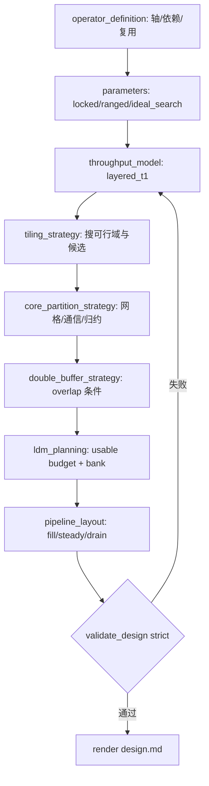

---
name: sdaa-op-design
description: 在一代芯片约束下产出算子设计文档。v3 重点支持给定 shape 的方案搜索，以及不给 shape 时的 ideal-shape 上界探索。设计内容覆盖算子语义、shape 模式、分层吞吐模型、分块、分核、双缓冲、LDM/bank、流水。默认存于 teco-ops/op_design 对应算子目录。
---

# SDAA 算子设计（workflow v3）

## 用途

本 skill 用于**设计阶段**，不是泛化的文档模板。

适用场景：

- 用户给定 shape，要设计一代芯片上的最优或近最优方案
- 用户不给 shape，要探索理论甜点 shape 和性能上界
- 需要把分块、分核、双缓冲、LDM、流水写成可校验的 design.json

## 设计前置：性能最佳实践入口

进入设计前必须先读取 `../sdaa-performance-best-practices/SKILL.md`，用它完成机制层和算子族路由，再消费已验证经验：

```bash
rg -n "<op_family>|<api>|<mechanism>|<dtype>|<layout>" \
  ops/sdaa-op-learning-validation/references/learned-patterns
```

- 新算子开发：在 `init_design.py --from-requirement` 前完成检索。
- 已有算子优化：在选择 isolated / combination attempt 前完成检索。
- 若命中 SATE / Tensor / Layout / DoubleBuffer / gemm_write 等关键词，通过 `sdaa-performance-best-practices` 检索 learned-patterns 获取相关经验。
- 优先采用 `verified_by_stage` / `promoted` pattern；`draft_from_source` 只能作为候选假设。
- 设计文档中的 `double_buffer_strategy`、`ldm_planning`、`pipeline_layout` 应体现适用 pattern；若不采用命中的 pattern，需要写清不适用原因。

## 三种 shape 模式

- `locked`
  用户已给定 shape，目标是找该 shape 下的最优候选。
- `ranged`
  用户给定 shape 区间，目标是找稳定方案和切换点。
- `ideal_search`
  用户不给 shape，目标是探索一代芯片上的理想 shape 和理论上界。

## 强流程门禁

| 阶段 | 命令 | 允许空置 |
|------|------|:---:|
| 初始化草稿 | `init_design.py` | ✓ |
| 结构校验 | `validate_design.py --draft` | ✓ |
| 完成设计 | `validate_design.py` | ✗ |
| 渲染 MD | `validate_design.py --render-md` | ✗ |

v3 的 strict 校验不只检查“字段是否填写”，还检查基础物理一致性：

- matmul 的 shape keys 是否是 `M/N/K`
- grid rows*cols 是否等于 `slave_core_num`
- LDM 总量是否超过 usable budget
- GEMM 的 `N2/K2` 是否满足 T1 粒度
- 双缓冲开启时是否真的定义了 overlap
- 是否满足 T1 硬件一致性检查清单：DMA stride、LDM bank、ACE/SIMD、RMA 路径和同步门禁

## 设计流程



## 设计阶段的输出标准

一个合格的设计，必须能回答：

1. 为什么这个算子是 memory / compute / mixed / latency 瓶颈。
2. 为什么选这个 tile，而不是更大的 ACE tile。
3. 为什么选这个网格和通信方式。
4. 双缓冲是否值得做，成立条件是什么。
5. LDM 与两个 bank 如何分配。
6. 稳态迭代时间由哪一段主导。
7. 是否通过 [`hardware-checklist.md`](references/hardware-checklist.md) 中的 T1 硬件一致性检查。

## 命令

```bash
python3 ops/sdaa-op-design/scripts/init_design.py \
  --op my_op --computation-type matmul \
  --summary "T1 design draft"

python3 ops/sdaa-op-design/scripts/validate_design.py --op my_op --json
python3 ops/sdaa-op-design/scripts/validate_design.py --op my_op --render-md
```

> `--auto-design` 已移除：不要再走旧的 PVC family 搜索或自动候选生成。初始化后需要人工补齐
> `throughput_model`、`tiling_strategy`、`core_partition_strategy`、`double_buffer_strategy`、
> `ldm_planning`、`pipeline_layout` 等字段，并通过 `validate_design.py` strict 校验。

## schema v3 要点

- `operator_definition` 增加：
  `operator_family`、`independent_axes`、`reduction_axes`、`reuse_axes`
- `parameters` 增加：
  `shape_mode`、`shape_keys`、`locked_shapes`、`shape_ranges`、`ideal_shape_goal`
- `throughput_model` 升级为：
  `model_type=layered_t1` + `hardware_caps` + `traffic_model` + `stage_time_model_us`
- `tiling_strategy` 增加：
  `hierarchy`、`selected_tile`、`search_space`、`constraints`
- `core_partition_strategy` 增加：
  `grid_shape`、`split_dimensions`、`communication_pattern`、`loader_assignment`
- `ldm_planning` 增加：
  `usable_budget_bytes`、`bank_allocation`、`pressure_summary`
- `pipeline_layout` 增加：
  `steady_state_stages`、`overlap_pairs`、`wait_points`

## 注意

- `scaffold.family` 仅作为设计元数据，用于提示 teco-ops 落地形态。
- `manual` family 允许 design 阶段存在，后续按 teco-ops interface + UAL 布局人工落地。
- 设计通过不等于实现完成；本 skill 的重点是把设计阶段做实。

## 参考

| 文档 | 内容 |
|------|------|
| [workflow.md](references/workflow.md) | v3 流程与三种 shape 模式 |
| [design-schema.md](references/design-schema.md) | schema v3 字段说明 |
| [throughput-model.md](references/throughput-model.md) | layered_t1 性能模型 |
| [ldm-planning.md](references/ldm-planning.md) | usable budget + bank 规划 |
| [hardware-checklist.md](references/hardware-checklist.md) | T1 实机口径、DMA/RMA/LDM/ACE/SIMD 硬件一致性检查 |
| [completeness-checklist.md](references/completeness-checklist.md) | strict 校验要求 |
| [example-gemm-locked.md](references/example-gemm-locked.md) | locked-shape GEMM 手工设计初始化示例 |

硬件事实以 learned-patterns 中的已验证经验为准；本 skill 只负责把这些事实转成设计阶段可校验的字段和门禁。
